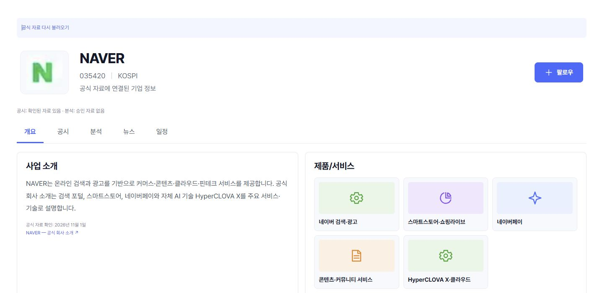
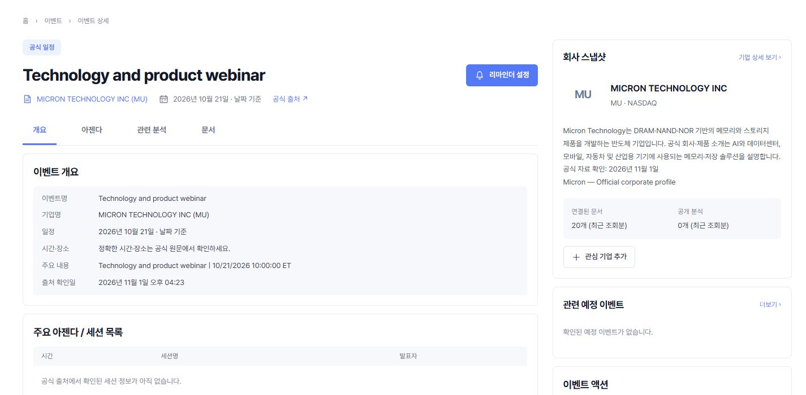
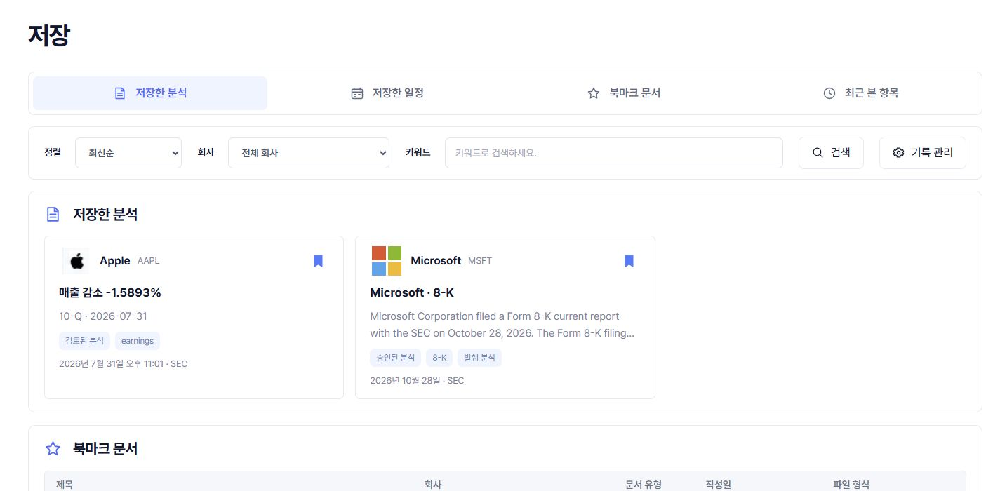

# 로그인 후 검색·기업 소개·캘린더·저장 기능 수정 및 운영 검증

- 작성일: 2026-11-01 UTC
- 운영 주소: <https://signalbrief.online>
- 최초 실화면 재현 기준: `16a3c7466e101465ccf71c0d52c262a28e98cd85`
- 첫 운영 수정: `83802e717a5a6e431a799faf656468e2b979bb9e`
- 최종 런타임 수정: `7043dd7eb6c333d76c1250c789a701c1e04baadd`
- 운영 배포 커밋(브라우저 locator 수정 포함): `85d3667a1bed15e71a534cf6161686d58419d7f5`
- 최종 후속 배포·로그인 인수 상태: **운영 배포 완료. 확인한 흐름 통과. 검색 결과의 뒤로 가기 실화면 검증은 Cold Turkey 차단으로 제한.**
- 운영 인수 기록 시각: 2026-11-01 08:09:56 UTC

## 1. 무엇을 고쳤는가

관심 기업과 캘린더의 기업 선택기가 등록된 회사만 조회하던 구조를 공식 기업목록 검색에 연결했다. 해외 검색은 시장 필터를 결과 제한 전에 적용하고, 검색 결과와 충돌하는 빈 목록 안내를 제거했다. 검증된 기업 기본정보를 소개에 표시하는 일반 경로를 추가하고, NAVER·LS·Micron의 사업 소개는 별도로 확인한 공식 출처로 보완했다.

Micron의 공식 IR 일정 수집 경로도 추가했다. 운영 수집기가 실제 원문을 보관하고 최근 과거 행사 3건을 반영한 것을 확인했다. 저장 화면에서는 검토 분석의 분류, 필터 안내, 계정·자료 변경 시 저장 버튼 상태를 수정했다.

첫 배포 뒤 실제 로그인 화면에서 추가로 발견한 세 문제도 수정했다. 기업 상세에서 뒤로 돌아왔을 때 검색 조건이 사라지던 문제, 일정 상세의 회사 요약이 새 소개를 사용하지 않던 문제, 개인 일정의 기업 검색창에서 Enter가 일정 제출을 시도하던 문제다. 아래에는 최초 재현, 자동 검증, 운영 화면 확인을 구분해 기록한다.

## 2. 실제 화면에서 확인한 원인

사용자가 사용 중인 기존 탭과 별도로, 같은 로그인 세션의 점검 탭을 사용했다.

| 화면·입력 | 수정 전 실화면 관찰 | 코드 원인과 수정 |
|---|---|---|
| 관심 기업 메인 `ls` | 현재 관심 기업에 일치하는 항목이 없다는 안내만 표시 | 메인 검색이 팔로우 목록만 필터링했다. 기존 목록과 함께 전체 공식 기업 검색·명시적 추가를 제공한다. |
| 관심 기업 → 기업 추가 → `LS` | 공식 기업목록에 있는 LS를 선택할 수 없음 | 추가 창이 등록 기업 조회만 사용했다. 공식 회사 식별자를 검증하고 활성화한 뒤 명시적으로 관심 등록한다. |
| 기업 → `micron` → 해외주식 | MU 공식 결과와 “조건에 맞는 등록 기업이 없습니다”가 함께 표시 | 검색 결과 자체는 있었다. 상충하는 안내를 제거하고, 시장·출처 필터를 SQL LIMIT 이전에 적용했다. |
| 캘린더 기업 검색 `LS`, `micron` | 공식 기업을 찾고 선택할 수 없음 | 등록 기업 전용 선택기를 공통 공식 검색·선택 경로로 연결했다. 기업 선택만으로 관심 등록·개인 일정을 만들지 않는다. |
| NAVER 상세 | 대표자·설립일·업종은 있었지만 사업 소개·제품·사업 영역이 비어 있음 | 기본 profile과 사업 소개 경로가 분리돼 있었다. 공식 기본정보 projection과 검증된 사업 소개를 표시한다. |
| SNDK 상세 | SEC 업종과 공시는 있지만 소개에는 미제공 문구 | 회사별 임시 설명문에 의존하지 않도록 검증된 공식 profile의 업종·법적 이름·출처·확인 시각을 소개에도 사용한다. |
| 저장 | 확인한 계정에 저장 항목이 없고 열람 기록도 꺼져 있음 | 이 관찰만으로 데이터 유실을 확정하지 않았다. 별도로 발견한 분석 분류·필터·저장 상태 오류를 수정하고 실제 저장 왕복으로 확인했다. |
| 기업 검색 → 상세 → 뒤로 가기 | 검색어와 해외주식 필터가 초기화됨 | `companies.tsx`의 컴포넌트 상태에만 저장됐다. 검색어·시장·페이지를 URL에 저장해 뒤로 가기·새로고침에서 복원한다. |
| Micron 일정 상세 → 회사 스냅샷 | 기업 상세에는 소개가 있지만 요약에는 “등록된 기업 설명이 없습니다” | 사이드바가 `summary`만 읽었다. 문서·분석·일정 상세에서 같은 출처 기반 소개 컴포넌트를 사용한다. |
| 개인 일정 → 관련 기업 검색 → Enter | 부모 일정 폼 제출을 시도해 빈 필수 제목으로 포커스 이동 | 검색 입력창의 Enter 기본 제출을 차단했다. 제목이 비어 있어 운영 일정은 생성되지 않았다. 제목을 채운 경우도 별도 브라우저 회귀로 검증한다. |

공식 식별자는 LS `006260 / OpenDART 00105952`, NAVER `035420 / OpenDART 00266961`, Micron `MU / SEC 0000723125`로 연결했다. 회사명 문자열이나 사용자가 입력한 검색어만으로 다른 회사의 정보를 붙이지 않는다.

## 3. 정확한 수정 위치와 설계

### 기업 검색·선택

- `apps/web/src/redesign/company-discovery.tsx`: 기존 공식 검색에 선택 콜백을 추가했다. 응답 검증, 활성화 실패·재시도, 중복 활성화 방지, 수집 미완료 표시를 함께 처리한다.
- `apps/web/src/redesign/watchlist.tsx`: 메인·추가 창 검색과 명시적인 관심 등록을 연결한다.
- `apps/web/src/redesign/calendar.tsx`: 조회 기업 범위와 개인 일정 관련 기업 선택에 같은 공식 검색을 사용한다. 관련 기업 검색의 Enter는 일정 폼을 제출하지 않는다.
- `apps/web/src/redesign/companies.tsx`: 검색 결과의 상충하는 빈 안내를 제거하고 `q`, `market_group`, `offset`을 URL에 유지한다. 새 검색·시장 변경은 페이지를 초기화한다. 잘못된 시장·페이지 값은 기본값으로 제한한다.
- `apps/web/src/app/api/company-discovery/route.ts`, `supabase/functions/signalbrief-discovery/index.ts`: 허용된 필터를 검증해 보호 RPC로 전달한다.
- `supabase/migrations/20261101072155_company_picker_discovery_filters.sql`: `sb_company_discovery_filtered(q,p)`가 출처·시장 조건을 먼저 적용하고 그 결과를 제한한다.

SEC 출처는 해외 기업 분류 근거로 사용한다. DART의 기업목록에 없는 거래소를 임의로 코스피·코스닥으로 추정하지 않는다. 기업개황으로 확인한 시장이 있으면 사용한다. 검색만으로 사용자의 관심 기업이나 개인 일정은 생성되지 않는다. 명시적으로 기업을 선택하면 해당 회사의 공용 profile·공시 수집에 필요한 활성화와 보관은 발생할 수 있다.

### 기업 소개와 상세 요약

- `supabase/migrations/20261101072153_company_official_overview.sql`: 정확한 회사 ID·provider·공식 코드·ticker와 보관 원본에 묶인 `official_overview`를 제공한다.
- `apps/web/src/lib/company-overview.ts`, `apps/web/src/components/company-introduction.tsx`: 제공된 사실과 출처·조회 시각을 표시한다. 업종 코드만 있으면 업종명으로 오인하지 않게 표시한다.
- `apps/web/src/lib/company-business-profiles.ts`: NAVER·LS·Micron의 공식 사업 소개·제품·사업 영역을 추가했다. LS 지주회사와 계열사의 역할을 구분한다.
- `apps/web/src/components/company-snapshot-introduction.tsx`: 상세 사이드바에서 검증된 사업 소개 → 공식 기본정보 → 기존 요약 순서로 표시한다.
- `apps/web/src/redesign/company.tsx`, `companies.tsx`, `event.tsx`, `analysis.tsx`: 기업 카드·상세·일정·문서·분석에 해당 경로를 연결한다.

이 소개 연결은 카드마다 새 profile 요청을 만들지 않는다. 이미 반환된 검증 자료를 재사용한다. 모든 회사의 제품·사업 부문·분석을 자동으로 완성했다는 뜻은 아니다. SEC 기업정보에 없는 대표자·설립일은 원천 미제공이라고 설명한다.

### 저장

- `apps/web/src/redesign/saved.tsx`: 기존 `kind: event` 검토 분석을 저장한 분석으로 분류한다. 실제 캘린더 관심 일정은 별도 ID·RPC를 유지한다. 빈 저장 목록과 필터에 가려진 결과를 구분하며 탐색·필터 초기화 동작을 제공한다.
- `apps/web/src/redesign/analysis.tsx`, `ui.tsx`: 저장 상태를 계정 토큰·정확한 리소스 종류·ID에 묶어 이전 계정이나 자료의 늦은 응답이 현재 버튼에 적용되지 않게 했다.

저장 소유권·공개 상태 검증을 유지한다. 운영 계정의 유실된 항목을 복원했다고 주장하지 않는다. 열람 기록을 임의로 켜지도 않았다.

### Micron 공식 일정

- `supabase/functions/signalbrief-calendar/micron-q4.ts`: 고정된 공식 공개 Q4 feed를 읽는다. 공식 webcast 태그만 일정으로 취급하며 risk-factor 게시물은 제외한다.
- `supabase/functions/signalbrief-calendar/index.ts`: 기존 수집기에 Micron 분기를 연결한다.
- `supabase/migrations/20261101072157_micron_q4_calendar.sql`: JSON 원본·manifest 보관 검증과 서비스 전용 반영 RPC를 추가한다.

모든 페이지와 명시적인 빈 마지막 페이지를 보관하고 SHA-256으로 manifest에 묶는다. 불완전 수집, 전체 기록의 예상 밖 공백, 잘못된 날짜·시간대, 원본 보관 실패는 기존 일정을 철회하지 못한다. 아직 MU가 없는 신규 DB에서도 migration이 통과하며 가짜 회사를 만들지 않는다. 정확한 공식 식별자의 기업 활성화 뒤 기존 스케줄러에 연결한다. 운영자가 꺼둔 설정과 기존 HTML adapter 경로를 보존한다.

공식 일정의 현재 저장·표시·내보내기 정밀도는 날짜다. 이를 종일 행사로 오해하지 않도록 `날짜 기준`이라고 표시하며, 원문 시각은 인용에 보존한다.

## 4. 운영 화면 인수 결과

아래 첫 묶음은 첫 운영 수정 `83802e7`에서 직접 확인했다. 최종 후속 수정 `85d3667`은 운영 배포 및 릴리스 일치 확인 뒤 별도로 인수했다. 마지막 검색 결과 단계는 Cold Turkey 차단 화면 때문에 운영 통과로 표시하지 않는다.

| 확인 흐름 | 실제 결과 |
|---|---|
| 관심 기업 메인 `ls` | 공식 LS 결과 표시 |
| 추가 창 `006260` → 명시적 추가 → 새로고침 | LS 카드 유지, `006260 / KOSPI` 확인 |
| LS 상세 | 사업 소개·계열사 범위 안내·대표자·설립일·최신 DART 공시 표시 |
| 기업 `micron` + 해외주식 | MU 결과 표시, 상충하는 등록 목록 빈 안내 없음, 상세 연결 정상 |
| NAVER 상세 | 사업 소개·제품·사업 영역·공식 출처 표시 |
| SNDK 상세 | 일반 공식 소개 경로로 `Computer Storage Devices`, SEC 출처, 조회 시각 표시 |
| 캘린더 `ls` | LS 검색·선택 가능. 공식 일정 수집 미연결 상태를 별도 안내 |
| 캘린더 `micron`, `MU` | 선택 가능. 지난 일정 3건, 확인한 미래 일정 0건 표시 |
| Micron 가장 가까운 일정 보기 | 2026-10-21 달력으로 이동하며 해당 행사 표시 |
| Micron 일정 상세 | 행사명·날짜·공식 출처·원문 `10/21/2026 10:00:00 ET` 표시 |
| 공시·승인 분석·검토 분석·공식 일정 저장 | 4개 항목이 각각 문서·분석·일정 섹션에 표시 |
| 저장 화면 새로고침 | 4개 항목 유지, 정확한 상세 링크 유지 |
| 저장 회사 필터 LS → 초기화 | 조건에 맞는 저장 없음 안내 후 원래 4개 항목 복원 |
| 개인 일정 관련 기업 `006260` 선택 → 취소 | LS의 실제 회사 ID가 선택됨. 운영 개인 일정은 생성하지 않음 |
| 홈 기본 기간 | 2026-10-03~2026-11-01, 공시 85건·승인 분석 26건·확정 일정 4건 표시 |
| 최종 후속: 검색 조건 → 상세 → 뒤로 → 새로고침 | 자동 데스크톱·모바일 회귀와 정확한 커밋 CI 통과. 운영 검색 URL에서 `Blocked by Cold Turkey`가 표시돼 이 단계의 최종 운영 재확인은 제한 |
| 최종 후속: Micron 일정·문서 회사 요약 | 두 상세 화면에서 사업 소개·공식 출처·확인 날짜 표시를 직접 확인 |
| 최종 후속: 제목 입력 후 기업 검색 Enter | 제목을 채우고 Enter를 눌러도 폼 유지. LS의 정확한 회사 ID 선택 후 취소했으며 운영 개인 일정은 생성되지 않음 |

검증용으로 추가한 LS·Micron 관심 등록과 위 저장 4개는 해제했다. 기존 관심 등록은 유지했다. 꺼져 있던 방문 기록 저장은 그대로 두었다. 실제 공식 기업 활성화로 확보한 회사·profile·공시·원문은 공용 서비스 자료이므로 삭제하지 않았다.

### 운영 화면 캡처

아래는 계정 메뉴를 제외한 공개 기업 내용과 이번 검증으로 만든 저장 항목이다. 저장 캡처는 확인용 항목을 해제하기 전에 촬영했다.

## 5. 검증 증거

서로 겹치는 집중 테스트 숫자를 합산하지 않는다. 합성 fixture 검증, 실제 공식 원문 재생, 운영 화면 인수는 서로 다른 근거다.

| 검증 | 결과·범위 |
|---|---|
| 첫 수정 전체 로컬 verifier | 2026-11-01 07:21:04 UTC, 8단계 통과; backend 571건·건너뜀 0건, frontend 1,041건·94개 파일 |
| 첫 수정 브라우저 | 로컬·정확한 `83802e7` 브랜치 CI·main CI 각각 84/84 통과 |
| 후속 수정 전체 로컬 verifier | 07:45:19 UTC, 8단계 통과; backend 571건·건너뜀 0건, frontend 1,054건·94개 파일. 마지막 Enter 방어 이전 실행으로 구분 |
| 최종 Enter 방어 포함 frontend | 1,054건·94개 파일, TypeScript·ESLint·production build 통과. ESLint 오류 0건·기존 경고 5건 |
| 최종 후속 브라우저 | 정확한 `85d3667` 코드·테스트로 84/84 통과; 데스크톱 42·모바일 42, 3.5분. 검색 조건 복원·Enter 방어 회귀 포함 |
| 최종 정확한 `85d3667` CI | verification·financial 모두 통과. 웹 작업의 브라우저 84/84, 3.1분, 08:01:14 UTC 완료. 변경 없는 calendar·collector workflow는 경로 필터로 미실행 |
| 최종 main 반복·운영 health | 같은 `85d3667`의 main verification·financial·hosted schema·reference·Release QA 모두 통과. main 브라우저 84/84, 4.3분, 08:11:32 UTC 완료. 운영 health도 실제 운영 origin·커밋·Edge/DB·인증 준비 상태 통과 |
| 서버·DB 집중 검증 | 공식 소개·검색 필터·Micron 원본 보관·식별자·RLS·소유권 검증 포함. 일회용 PostgreSQL 4개에서 실행 |
| Deno·scope guard | API·US·profiles·discovery·collector·calendar의 6개 진입점 통과. 보호 파일 90개·유지 기능 17개·진입점 2개 범위 검사 통과 |
| 보안 advisor 전후 | 새 경고 0개. 기존 경고가 모두 해소됐다는 의미는 아님 |
| 운영 비로그인 검색 | 최종 배포에서도 `/api/company-discovery?q=LS` → 401 `authentication_required` |
| 최종 배포 오류 로그 | Vercel의 이 배포 error/fatal 조건에 일치하는 로그 없음. 조회 창 07:53:28~08:08:28 UTC이며 전체 시스템 무오류 보증은 아님 |

검색 조건 복원 회귀는 기존 코드에서 3건 실패를 재현했다. 상세 요약 회귀는 기존 코드에서 6건 실패를 재현했다. Enter 방어는 취소되지 않은 키 입력을 재현하고, 실제 브라우저에서 제목·날짜를 채운 후 Enter로 일정 POST가 발생하지 않으며 명시적 Save에서만 정확한 회사 ID로 1건 생성되는지 확인한다.

개인 기업 선택의 새 브라우저 회귀는 동적 select 라벨을 `getByLabel`로 찾는 한 줄에서 실패했다. 실제 선택 값과 일정 미생성 상태는 맞았으며, 접근성 역할 `combobox`로 locator만 바꿔 데스크톱·모바일 집중 2건이 통과했다. 정확한 선택 값·저장 전 0건·명시적 저장 1건 검증은 유지했다. 이 테스트 수정까지 포함한 운영 배포 커밋이 `85d3667`이다.

후속 build 한 번은 제한된 실행 환경에서 TypeScript `--showConfig` 출력 파싱 오류로 실패했다. 소스를 바꾸지 않고 기존 전체 verifier와 같은 승인된 실행 환경에서 재실행해 통과했다. 해당 실패 로그와 성공 로그를 구분해 보존한다.

주요 CI와 구조화된 기록:

- 최종 브랜치 verification: <https://github.com/JackRo682/SignalBrief/actions/runs/41286660215>
- 최종 financial benchmark: <https://github.com/JackRo682/SignalBrief/actions/runs/41286660192>
- 최종 main verification: <https://github.com/JackRo682/SignalBrief/actions/runs/41287164831>
- 최종 운영 health: <https://github.com/JackRo682/SignalBrief/actions/runs/41287202101>
- 첫 수정 브랜치: <https://github.com/JackRo682/SignalBrief/actions/runs/41284733771>
- 첫 수정 main: <https://github.com/JackRo682/SignalBrief/actions/runs/41285171094>
- 첫 수정 Production health: <https://github.com/JackRo682/SignalBrief/actions/runs/41285247573>
- 구조화된 상세 증거: `verification/cross-screen-2026-11-01.json`

CI의 별도 hosted PostgreSQL 작업은 69건 통과·130건 건너뜀·372건 선택 제외로, 필요한 일부 일회용 DB URL이 없는 작업이다. 이 CI 결과를 건너뜀 0건으로 표현하지 않는다. 네 개 DB를 모두 제공한 로컬 backend 571건·0 skip이 전체 DB 회귀 근거다.

## 6. 운영 서버와 실제 수집 결과

| 항목 | 적용 상태 |
|---|---|
| 공식 소개 migration | `20261101072153` 적용 |
| 공식 검색 필터 migration | `20261101072155` 적용 |
| Micron 수집 migration | `20261101072157` 적용 |
| discovery Edge | v5 ACTIVE |
| calendar Edge | v2 ACTIVE |
| 첫 프런트엔드 배포 | `dpl_DHDAaUAxQ2AFPj9KEbKB7r6zsA8P`, READY, `/api/release`가 `83802e7`과 main 반환 |
| 최종 후속 프런트엔드 | `dpl_5GwC4oZFMor1g7Wxuzq1CArKQMLT`, READY. 운영 `/api/release`가 정확한 `85d3667`과 main 반환 |

기존 운영 스케줄러를 통해 실행한 request 5695는 07:23:04.153494 UTC 완료됐다. 결과는 Micron 3건 verified, Microsoft 5건 verified, Samsung `no_confirmed_dates`다.

| Micron 행사 | 확인된 날짜 |
|---|---|
| Technology and product webinar | 2026-10-21 |
| Micron's Fourth Quarter 2026 Financial Call | 2026-09-30 |
| Micron's Post Earnings Analyst Call | 2026-09-30 |

공식 목록 <https://investors.micron.com/events-and-presentations/>의 전체 feed 39개 기록과 빈 마지막 페이지를 확인했다. 운영 수집기가 자신의 원문 2개와 manifest를 보관했다. manifest SHA-256은 `06f6818ceddd709b39dab5c0e1cbe835ffc1d9143c1cbe1baa4372caf44e3cc8`이다. 원문 시각은 ET이며 `America/New_York` 출처 시간대와 연결했다. 이번 원문 조회에서 확인한 미래 행사는 0건이다.

## 7. 사업 소개 출처 보관

공식 출처의 캡처·메타데이터·해시는 별도 보존용 ZIP으로 보관했다. 아래 해시는 명시한 캡처 형식의 바이트 기준이다. LS는 직접 HTML 요청이 HTTP 999로 차단되어 공식 페이지 조회로 얻은 텍스트 발췌본을 보관했다. 이를 원본 HTML이라고 부르지 않는다.

| 기업 | 공식 출처 | 캡처 형식 | SHA-256 |
|---|---|---|---|
| NAVER | <https://www.navercorp.com/company/about> | HTML | `45d679064a24e882daf17b71d03a18f1dca011e30b3e66099e8678edbc77e747` |
| LS | <https://lsholdings.co.kr/en/about/status> | 공식 페이지 조회 텍스트 발췌 | `4b606fef04ec4311ac4d75f1c49fed307f13831ae94fe4179db5568e8fc079e8` |
| Micron | <https://www.micron.com/about/company/corporate-profile> | HTML | `817c028f8000200ffb880dd1ee352b09a1f58285ba857233e68ce8178c773891` |

## 8. 남은 자료 범위와 상용 판단

**브라우저 환경 제한:** 운영 검색 URL `/explore?q=micron&market_group=overseas`에서 Cold Turkey가 차단 화면을 표시했다. 검색 조건 복원은 자동 회귀와 CI에서 통과했지만, 이 운영 브라우저의 최종 뒤로 가기 단계는 재확인하지 못했다. 확장 프로그램 설정을 변경하거나 차단을 우회하지 않았다. 독립적인 일정·문서 상세 및 개인 일정 확인은 허용된 해당 화면에서 완료했다.

검색·화면 동작과 자료 확보 범위는 구분한다. 이번 점검 시 등록 기업은 11개이며, 연결된 공식 일정 수집 출처는 Microsoft·Samsung·Micron 3개다. 전체 공식 기업목록을 검색할 수 있다는 사실이 모든 회사의 일정·제품·분석 자료가 완비됐다는 뜻은 아니다.

- **LS 일정:** 최근 또는 예정 행사를 뒷받침하는 공식 자료를 이번 점검에서 확인하지 못했다. 검색·선택은 가능하지만 일정 수집은 미연결로 안내한다. LS의 행사가 전혀 없다고 단정하지 않는다.
- **Micron 일정:** 수집한 3건은 과거 행사다. 11월이나 미래 일정 0건을 숨기기 위해 가짜 일정을 만들지 않는다. 가까운 과거 일정으로 이동할 수 있다.
- **일반 기업 소개:** SNDK는 공식 기본정보와 출처를 표시한다. 모든 기업의 제품·사업 영역이 자동으로 채워진 것은 아니다.
- **분석·수치:** 공개 승인을 받지 않았거나 기간·단위·원문 근거가 확인되지 않은 자료를 임의로 공개하지 않는다. 새로 활성화한 회사의 공시는 있어도 승인 분석·수치가 없을 수 있다.
- **Samsung 일정:** 현재 공식 Upcoming Events 목록은 비어 있고 기존 보수적 `no_confirmed_dates` 상태가 남아 있다. 예정일을 놓친 새 파서 결함은 발견되지 않았다. 모든 수집 소스가 오류 없이 정상이라고 주장하지 않는다.
- **시간 정밀도:** 공식 일정은 날짜로 표시·내보낸다. 원문에 있는 시각을 사용자 시간대로 변환한 정확한 시작 시각으로 제공한다고 주장하지 않는다.
- **전체 품질:** 이번 기능 경로의 회귀·권한·운영 검증은 상용 배포의 근거다. 모든 종목의 자료 완비나 전체 제품의 버그 0개를 보증하지 않는다.

복구가 필요하면 최종 후속 UI를 직전 검증된 `83802e7`로 되돌릴 수 있다. 전체 첫 수정 이전에는 `16a3c74`가 있었다. 추가 migration은 기존 RPC와 호환되며, 사용자 저장 항목·공식 원문·활성화한 회사를 삭제하는 복구는 하지 않는다. 현재 릴리스에서는 모델 승인 우회, 자동 분석 공개, 수집 주기·비용 한도 확대를 수행하지 않았다.
